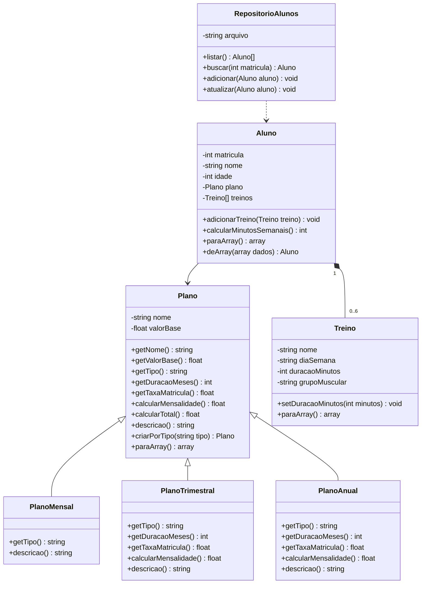

# Modelagem - Academia Iron Force

## Diagrama de classes

## Justificativas

### Herança: Plano → PlanoMensal, PlanoTrimestral, PlanoAnual

Os três planos **são** um plano: todos têm nome, valor base, mensalidade e total do contrato.
O que muda é a regra de cálculo, então a classe mãe guarda o que é comum e as filhas sobrescrevem só o que difere:

| Método sobrescrito | Mensal | Trimestral | Anual |
|--------------------|--------|------------|-------|
| `getDuracaoMeses()` | 1 (herdado) | 3 | 12 |
| `calcularMensalidade()` | valor base (herdado) | 10% de desconto | 20% de desconto |
| `getTaxaMatricula()` | R$ 50 (herdado) | R$ 25 | R$ 0 |
| `getTipo()` e `descricao()` | sim | sim | sim |

Assim `calcularTotal()` fica escrito uma única vez na classe mãe e funciona para todos, pois chama os métodos que cada filha responde do seu jeito (polimorfismo).
Os atributos da classe mãe são `private` e as filhas acessam por getters, e cada filha chama `parent::__construct`.

### Composição: Aluno tem Treinos

Um `Treino` só faz sentido como parte da rotina de um aluno, por isso o `Aluno` guarda a lista de treinos (`*--`).
O método `adicionarTreino()` aplica as regras da lista (no máximo 6 treinos e um treino por dia) e `calcularMinutosSemanais()` calcula o total sobre a lista.

### Aluno → Plano (associação)

O aluno **usa** um plano, mas o plano existe sem o aluno (a página de planos mostra planos sem nenhum aluno). Por isso é associação simples (`-->`), e não composição.

### RepositorioAlunos

Isola a persistência em arquivo JSON (bônus). As demais classes não sabem de arquivo nenhum, e a conversão usa `paraArray()` e `Aluno::deArray()`.

## Regras de negócio (todas com `throw new Exception`)

1. Valor base do plano maior que zero.
2. Tipo de plano deve ser mensal, trimestral ou anual.
3. Nome do aluno com pelo menos 3 caracteres.
4. Aluno com pelo menos 16 anos (e no máximo 100).
5. Duração do treino entre 10 e 180 minutos.
6. Dia da semana do treino válido.
7. Grupo muscular obrigatório no treino.
8. Um treino por dia da semana para cada aluno.
9. Máximo de 6 treinos por aluno.
10. Não pode haver dois alunos com o mesmo nome.